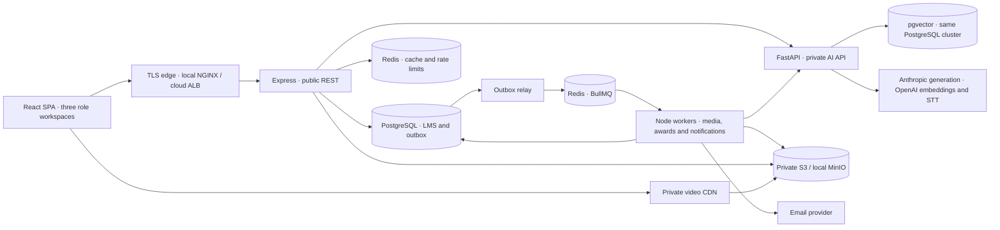
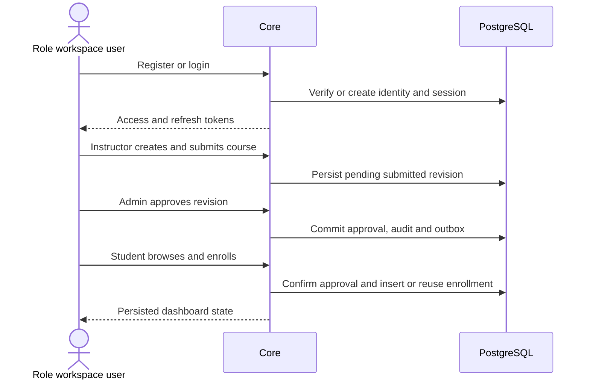
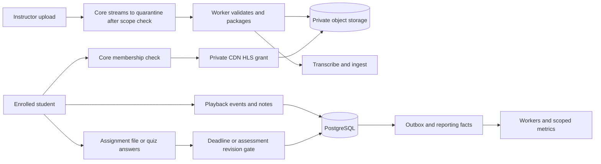
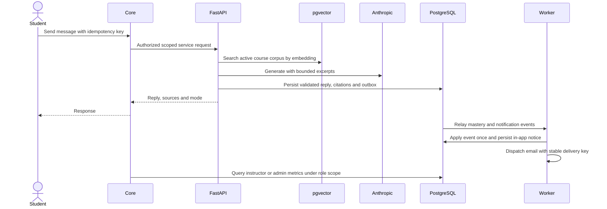

# Architecture

## Components

Core owns auth, governance, enrollment, grading and learner state. AI owns scoped chats and vector data. Use separate DB roles and pool budgets. Core verifies bearer/session/role and resource policy before forwarding a request to AI. Use private network routes and a 60-second service JWT signed with a distinct key, binding audience, service subject, actor, course, action and request ID. FastAPI verifies claims and current source scope before search. Job calls use a separate worker identity with allowed actions and resolve resource IDs from durable state. Strip untrusted forwarding and internal identity headers at the edge.

## Auth, approval and enrollment

## Playback, upload, assessment and reporting

Publish manifests, captions and media metadata after validation. Sign short-lived grants for the playlist and every segment under its versioned asset prefix. Use a path-scoped CDN cookie or a signed manifest with per-segment URLs. Verify expiry/revocation behavior in browser tests. Grading and enrollment are transactional. Reporting uses deduplicated events and relational facts, with a read replica when reporting competes with OLTP.

## Grounded tutoring and notifications

## Jobs and caching

| Job | Trigger and deduplication key | Recovery |
|---|---|---|
| Packaging and transcription | Valid upload and asset version | Resume from completed assets. Playback readiness is independent of STT. |
| Embeddings | Source version and embedding revision | Activate only a complete generation. |
| Mastery | Final grade or validated tutor event ID | Transactional ledger protects replay. |
| Recommendations | Nightly UTC and grade events | Swap rank snapshot after complete rebuild. |
| Streaks | Daily UTC and meaningful activity | Recompute from unique user/day. |
| Certificate | Learner and course completion | Upsert pending row, write deterministic PDF key, mark ready. |
| Notification | Event, recipient and channel | Durable delivery record, provider dedupe where supported, reconcile ambiguous sends. |

Commit outbox with business data. Relay and consumers tolerate at-least-once delivery. Use bounded retries with exponential backoff and jitter, terminal failed-job queue, operator replay and durable pending-job reconciliation after Redis loss. Payloads use IDs. AI has separate timeouts, pools and circuit breaker. Provider failure yields 503 and core CRUD/playback continues.

Use Redis catalog TTL 300 seconds, public course metadata TTL 300 seconds and leaderboard TTL 60 seconds. Increment catalog generation in the approval or course update transaction, use it in cache keys and evict stale keys after commit. Invalidate leaderboard after relevant grade/engagement changes. Perform private access checks before granting assets or cached AI results. Bound DB fallback on cache loss. See [operations](DEPLOYMENT_AND_OPERATIONS.md).

## Folder mapping

Keep PRD §10 paths `frontend/src/{components,pages,store,hooks,services,layouts,utils,styles,routes}`, `backend/src/{modules,middleware,jobs,config,db,utils}`, `backend/tests`, `ai-service/app/{routers,rag,recommendation,models,core}`, `infra` and `.github/workflows`. Store migrations and seeds under backend/src/db and AI tests next to the service. The approved Word document plus [requirements](PROJECT_REQUIREMENTS.md) replaces the proposed prd.md entry and this file is the architecture entry. ECS replaces optional Kubernetes manifests in the proposed cloud plan. Centralized course boundaries, scoped keys and service policies provide a starting point for future tenant isolation.
