# Database schema

[PRD §7](../Document/Project%20Document.docx) defines PostgreSQL as authoritative, pgvector as a PostgreSQL extension and Redis as cache/queue. The ledger below preserves the baseline field names, types and relationship constraints. Enforce proposed additions in a separately reviewed migration series.

## Entity relationships

```mermaid
erDiagram
  USERS ||--o{ USER_ROLES : has
  ROLES ||--o{ USER_ROLES : grants
  USERS ||--o{ COURSES : authors
  COURSES ||--o{ MODULES : contains
  MODULES ||--o{ LECTURES : contains
  USERS ||--o{ ENROLLMENTS : enrolls
  COURSES ||--o{ ENROLLMENTS : receives
  COURSES ||--o{ LEARNING_TOPICS : defines
  LEARNING_TOPICS ||--o{ MASTERY_EVENTS : tracks
  USERS ||--o{ MASTERY_EVENTS : demonstrates
  USERS ||--o{ LEARNER_MASTERY : has
  LEARNING_TOPICS ||--o{ LEARNER_MASTERY : summarizes
  ENROLLMENTS ||--o{ LECTURE_PROGRESS : records
  LECTURES ||--o{ LECTURE_PROGRESS : tracks
  USERS ||--o{ NOTES : owns
  LECTURES ||--o{ NOTES : annotates
  USERS ||--o{ BOOKMARKS : owns
  LECTURES ||--o{ BOOKMARKS : marks
  COURSES ||--o{ ASSIGNMENTS : assigns
  ASSIGNMENTS ||--o{ ASSIGNMENT_SUBMISSIONS : receives
  USERS ||--o{ ASSIGNMENT_SUBMISSIONS : submits
  MODULES ||--o{ QUIZZES : offers
  LECTURES o|--o{ QUIZZES : grounds
  QUIZZES ||--o{ QUIZ_QUESTIONS : contains
  QUIZ_QUESTIONS ||--o{ QUIZ_OPTIONS : offers
  QUIZZES ||--o{ QUIZ_ATTEMPTS : receives
  USERS ||--o{ QUIZ_ATTEMPTS : takes
  QUIZ_ATTEMPTS ||--o{ QUIZ_ANSWERS : contains
  QUIZ_QUESTIONS ||--o{ QUIZ_ANSWERS : receives
  USERS ||--o{ CERTIFICATES : earns
  COURSES ||--o{ CERTIFICATES : issues
  USERS ||--o{ USER_BADGES : earns
  BADGES ||--o{ USER_BADGES : defines
  USERS ||--o| STREAKS : tracks
  USERS ||--o{ AI_CHAT_SESSIONS : owns
  COURSES ||--o{ AI_CHAT_SESSIONS : scopes
  AI_CHAT_SESSIONS ||--o{ AI_CHAT_MESSAGES : contains
  COURSES ||--o{ DOCUMENT_CHUNKS : scopes
  LECTURES ||--o{ DOCUMENT_CHUNKS : anchors
  USERS ||--o{ STUDY_PLANS : owns
  COURSES ||--o{ STUDY_PLANS : scopes
  MODULES ||--o{ FLASHCARDS : owns
  USERS ||--o{ RECOMMENDATIONS : receives
  COURSES ||--o{ RECOMMENDATIONS : suggests
  COURSES ||--o{ DISCUSSION_THREADS : hosts
  USERS ||--o{ DISCUSSION_THREADS : creates
  DISCUSSION_THREADS ||--o{ DISCUSSION_POSTS : contains
  USERS ||--o{ DISCUSSION_POSTS : writes
  COURSES ||--o{ ANNOUNCEMENTS : hosts
  USERS ||--o{ ANNOUNCEMENTS : posts
  USERS ||--o{ NOTIFICATIONS : receives
  COURSES ||--o{ COURSE_APPROVALS : reviewed
  USERS ||--o{ COURSE_APPROVALS : reviews
  USERS ||--o{ PAYMENTS : associated
  COURSES ||--o{ PAYMENTS : attributed
  USERS o|--o{ AUDIT_LOGS : acts
```

The diagram shows logical ownership and principal relationships. The field ledger governs baseline SQL nullability and deletion behavior.

## PRD field ledger

| Entity | Baseline SQL fields and constraints |
|---|---|
| `users` | `id UUID PRIMARY KEY DEFAULT gen_random_uuid()` `full_name VARCHAR(150) NOT NULL` `email VARCHAR(180) UNIQUE NOT NULL` `password_hash VARCHAR(255) NOT NULL` `avatar_url TEXT` `is_active BOOLEAN DEFAULT TRUE` `created_at TIMESTAMPTZ DEFAULT now()` `updated_at TIMESTAMPTZ DEFAULT now()` |
| `roles` | `id SERIAL PRIMARY KEY` `name VARCHAR(30) UNIQUE NOT NULL -- student, instructor, admin` |
| `user_roles` | `user_id UUID REFERENCES users(id) ON DELETE CASCADE` `role_id INT REFERENCES roles(id) ON DELETE CASCADE` `PRIMARY KEY (user_id, role_id)` |
| `courses` | `id UUID PRIMARY KEY DEFAULT gen_random_uuid()` `instructor_id UUID REFERENCES users(id)` `title VARCHAR(200) NOT NULL` `description TEXT` `category VARCHAR(80)` `difficulty VARCHAR(20), -- beginner/intermediate/advanced` `thumbnail_url TEXT` `price NUMERIC(10,2) DEFAULT 0` `status VARCHAR(20) DEFAULT 'pending', -- pending/approved/rejected/archived` `created_at TIMESTAMPTZ DEFAULT now()` |
| `modules` | `id UUID PRIMARY KEY DEFAULT gen_random_uuid()` `course_id UUID REFERENCES courses(id) ON DELETE CASCADE` `title VARCHAR(200) NOT NULL` `order_index INT NOT NULL` |
| `lectures` | `id UUID PRIMARY KEY DEFAULT gen_random_uuid()` `module_id UUID REFERENCES modules(id) ON DELETE CASCADE` `title VARCHAR(200) NOT NULL` `video_url TEXT` `transcript TEXT` `duration_seconds INT` `order_index INT NOT NULL` `resource_urls TEXT[] -- PDFs, slides` |
| `enrollments` | `id UUID PRIMARY KEY DEFAULT gen_random_uuid()` `user_id UUID REFERENCES users(id)` `course_id UUID REFERENCES courses(id)` `enrolled_at TIMESTAMPTZ DEFAULT now()` `progress_percent NUMERIC(5,2) DEFAULT 0` `UNIQUE (user_id, course_id)` |
| `lecture_progress` | `id UUID PRIMARY KEY DEFAULT gen_random_uuid()` `enrollment_id UUID REFERENCES enrollments(id) ON DELETE CASCADE` `lecture_id UUID REFERENCES lectures(id)` `watched_seconds INT DEFAULT 0` `completed BOOLEAN DEFAULT FALSE` `last_watched_at TIMESTAMPTZ` |
| `notes` | `id UUID PRIMARY KEY DEFAULT gen_random_uuid()` `user_id UUID REFERENCES users(id)` `lecture_id UUID REFERENCES lectures(id)` `timestamp_seconds INT` `content TEXT` `created_at TIMESTAMPTZ DEFAULT now()` |
| `bookmarks` | `id UUID PRIMARY KEY DEFAULT gen_random_uuid()` `user_id UUID REFERENCES users(id)` `lecture_id UUID REFERENCES lectures(id)` `timestamp_seconds INT` `created_at TIMESTAMPTZ DEFAULT now()` |
| `assignments` | `id UUID PRIMARY KEY DEFAULT gen_random_uuid()` `course_id UUID REFERENCES courses(id)` `title VARCHAR(200)` `instructions TEXT` `rubric JSONB` `due_date TIMESTAMPTZ` |
| `assignment_submissions` | `id UUID PRIMARY KEY DEFAULT gen_random_uuid()` `assignment_id UUID REFERENCES assignments(id)` `user_id UUID REFERENCES users(id)` `file_url TEXT` `submitted_at TIMESTAMPTZ DEFAULT now()` `grade NUMERIC(5,2)` `feedback TEXT` |
| `quizzes` | `id UUID PRIMARY KEY DEFAULT gen_random_uuid()` `module_id UUID REFERENCES modules(id)` `title VARCHAR(200)` `is_ai_generated BOOLEAN DEFAULT FALSE` `generated_from_lecture_id UUID REFERENCES lectures(id)` |
| `quiz_questions` | `id UUID PRIMARY KEY DEFAULT gen_random_uuid()` `quiz_id UUID REFERENCES quizzes(id) ON DELETE CASCADE` `question_text TEXT` `question_type VARCHAR(20), -- mcq/multi_select/short_answer` `order_index INT` |
| `quiz_options` | `id UUID PRIMARY KEY DEFAULT gen_random_uuid()` `question_id UUID REFERENCES quiz_questions(id) ON DELETE CASCADE` `option_text TEXT` `is_correct BOOLEAN DEFAULT FALSE` |
| `quiz_attempts` | `id UUID PRIMARY KEY DEFAULT gen_random_uuid()` `quiz_id UUID REFERENCES quizzes(id)` `user_id UUID REFERENCES users(id)` `score NUMERIC(5,2)` `started_at TIMESTAMPTZ DEFAULT now()` `submitted_at TIMESTAMPTZ` |
| `quiz_answers` | `id UUID PRIMARY KEY DEFAULT gen_random_uuid()` `attempt_id UUID REFERENCES quiz_attempts(id) ON DELETE CASCADE` `question_id UUID REFERENCES quiz_questions(id)` `selected_option_ids UUID[]` `text_answer TEXT` `is_correct BOOLEAN` |
| `certificates` | `id UUID PRIMARY KEY DEFAULT gen_random_uuid()` `user_id UUID REFERENCES users(id)` `course_id UUID REFERENCES courses(id)` `certificate_url TEXT` `issued_at TIMESTAMPTZ DEFAULT now()` |
| `badges` | `id SERIAL PRIMARY KEY` `name VARCHAR(80)` `description TEXT` `icon_url TEXT` |
| `user_badges` | `user_id UUID REFERENCES users(id)` `badge_id INT REFERENCES badges(id)` `earned_at TIMESTAMPTZ DEFAULT now()` `PRIMARY KEY (user_id, badge_id)` |
| `streaks` | `user_id UUID PRIMARY KEY REFERENCES users(id)` `current_streak INT DEFAULT 0` `longest_streak INT DEFAULT 0` `last_active_date DATE` |
| `ai_chat_sessions` | `id UUID PRIMARY KEY DEFAULT gen_random_uuid()` `user_id UUID REFERENCES users(id)` `course_id UUID REFERENCES courses(id)` `mode VARCHAR(20) DEFAULT 'intermediate'` `created_at TIMESTAMPTZ DEFAULT now()` |
| `ai_chat_messages` | `id UUID PRIMARY KEY DEFAULT gen_random_uuid()` `session_id UUID REFERENCES ai_chat_sessions(id) ON DELETE CASCADE` `sender VARCHAR(10), -- user/ai` `content TEXT` `source_lecture_ids UUID[]` `created_at TIMESTAMPTZ DEFAULT now()` |
| `document_chunks` | `id UUID PRIMARY KEY DEFAULT gen_random_uuid()` `course_id UUID REFERENCES courses(id)` `lecture_id UUID REFERENCES lectures(id)` `chunk_text TEXT` `embedding VECTOR(1536)` `created_at TIMESTAMPTZ DEFAULT now()` |
| `ai_provider_usage` | Migration 013: actor/course, feature, provider/model, input/output token counts and timestamp; no prompt or response text |
| `learner_flashcards` | Migration 013: learner-owned module cards, content hash, supporting chunk IDs, last review and next due time |
| `learner_study_plans` | Migration 013: learner/course scoped JSON schedule and generation timestamp |
| `study_plans` | `id UUID PRIMARY KEY DEFAULT gen_random_uuid()` `user_id UUID REFERENCES users(id)` `course_id UUID REFERENCES courses(id)` `plan_json JSONB` `generated_at TIMESTAMPTZ DEFAULT now()` |
| `flashcards` | `id UUID PRIMARY KEY DEFAULT gen_random_uuid()` `module_id UUID REFERENCES modules(id)` `question TEXT` `answer TEXT` |
| `recommendations` | `id UUID PRIMARY KEY DEFAULT gen_random_uuid()` `user_id UUID REFERENCES users(id)` `recommended_course_id UUID REFERENCES courses(id)` `reason TEXT` `score NUMERIC(5,2)` `created_at TIMESTAMPTZ DEFAULT now()` |
| `discussion_threads` | `id UUID PRIMARY KEY DEFAULT gen_random_uuid()` `course_id UUID REFERENCES courses(id)` `created_by UUID REFERENCES users(id)` `title VARCHAR(200)` `created_at TIMESTAMPTZ DEFAULT now()` |
| `discussion_posts` | `id UUID PRIMARY KEY DEFAULT gen_random_uuid()` `thread_id UUID REFERENCES discussion_threads(id) ON DELETE CASCADE` `user_id UUID REFERENCES users(id)` `content TEXT` `is_flagged BOOLEAN DEFAULT FALSE` `created_at TIMESTAMPTZ DEFAULT now()` |
| `announcements` | `id UUID PRIMARY KEY DEFAULT gen_random_uuid()` `course_id UUID REFERENCES courses(id)` `posted_by UUID REFERENCES users(id)` `content TEXT` `created_at TIMESTAMPTZ DEFAULT now()` |
| `notifications` | `id UUID PRIMARY KEY DEFAULT gen_random_uuid()` `user_id UUID REFERENCES users(id)` `title VARCHAR(150)` `body TEXT` `is_read BOOLEAN DEFAULT FALSE` `created_at TIMESTAMPTZ DEFAULT now()` |
| `course_approvals` | `id UUID PRIMARY KEY DEFAULT gen_random_uuid()` `course_id UUID REFERENCES courses(id)` `reviewed_by UUID REFERENCES users(id)` `decision VARCHAR(20), -- approved/rejected` `comment TEXT` `reviewed_at TIMESTAMPTZ DEFAULT now()` |
| `payments` | `id UUID PRIMARY KEY DEFAULT gen_random_uuid()` `user_id UUID REFERENCES users(id)` `course_id UUID REFERENCES courses(id)` `amount NUMERIC(10,2)` `status VARCHAR(20), -- success/failed/refunded` `created_at TIMESTAMPTZ DEFAULT now()` |
| `audit_logs` | `id UUID PRIMARY KEY DEFAULT gen_random_uuid()` `actor_id UUID REFERENCES users(id)` `action VARCHAR(100)` `entity VARCHAR(50)` `entity_id UUID` `metadata JSONB` `created_at TIMESTAMPTZ DEFAULT now()` |

## Proposed schema extensions and invariants

| Area | Additions and transactional rules |
|---|---|
| Identity | Normalize login email, use encrypted email/full name and a unique keyed lookup digest, and preserve logical email uniqueness. Add refresh_sessions with token digest, family ID, rotation/expiry/revocation timestamps. Add deletion tombstone and role revision. |
| Catalog | Add pricing_tier, rating aggregate, submitted_at and content revision. Approval binds submitted revision and commits status, course_approvals and audit. Add media_assets for quarantine, manifest, captions and versioned object keys. URL fields represent storage references or sanitized public thumbnails. |
| `Progress` | Unique (enrollment_id, lecture_id), curriculum snapshot, required flags, durable playback event IDs and newest accepted playback session/sequence. Merge deduplicated valid coverage intervals and update course progress in the same transaction. Migration 015 adds rewatch_count and last_watched_at timestamp tracking. Use composite scope checks to reject mismatched enrollment/course/lecture links. |
| Assignments | Unique (assignment_id,user_id), pending scan asset and revision, server-clock acceptance. Add rubric_scores JSONB, grader and graded_at. Guard grade writes with revision. |
| Quizzes | Add draft/approved/rejected/retired state, immutable revision identity, grade status, topic and difficulty, question points and short-answer rubric. Unique (attempt_id,question_id) and one in-progress attempt per learner/quiz. Lock attempt on submit. Add objective score, final score and answer grade fields. |
| Awards | Unique certificate (user_id,course_id), status and deterministic object key. Badge uniqueness already exists. Add unique daily_activity (user_id,activity_date). |
| AI and personalization | Add source/version metadata, chunk ordinal, start/end seconds, page/slide, source asset/name, embedding_model, active source pointer and message citations JSONB. Unique source/version/ordinal/model. Store transcript segments separately from the baseline text. Migration 013 adds token-only provider usage, learner-owned flashcards/review scheduling and persisted study plans. Migrations 010 and 014 implement course learning_topics, append-only mastery_events with evidence kind, and learner_mastery score/confidence/updated_at. Quiz topic IDs must reference the same course; tutor self-assessment is explicit and tied to a saved reply. Migration 016 implements learner_targeted_recommendations supporting multi-signal inputs (quiz_scores, topic_mastery, assignments, enrollment_history, ai_tutor_questions) and target types (course, module, lecture). |
| Community | Add discussion_posts.parent_id with same-thread invariant, visibility and reports table with unique active reporter/post pair. Notification unique (event_id,user_id,channel), separate delivery state and provider reference. |
| Operations | Add durable outbox, replay keys, activity and reporting facts. Add synthetic payment provenance, currency and fixture source. Audit append-only, with separate reader roles and sanitized metadata. |

## Indexes and migration plan

Index foreign keys with B-trees, reusing a primary/unique leading key where sufficient. Keep enrollment unique (user_id, course_id), add course_id lookup, and add partial index on courses by submitted_at and id where status is pending. Add course/source-version B-tree for chunk filtering, quiz/graded_at for analytics, recipient/read status and stable pagination indexes. Defer optional discussion content GIN until full-text search is in scope.

Create the vector extension before the chunk table. Use text-embedding-3-small at 1536 dimensions and cosine distance. Start with exact retrieval within authorized active course material. Build the PRD IVFFlat cosine index after representative data exists. Compare filtered recall against exact search, tune probes/lists and use exact fallback if approximate recall is inadequate. Model changes stage a separate generation and matching index before atomic switch. [pgvector indexing and filtered searches](https://github.com/pgvector/pgvector).

Apply ordered migrations for identity/catalog/enrollment, learning/assets, assessments/awards, AI/personalization/extensions, community/governance/ops, video learning analytics, and recommendation engine (`backend/src/db/migrations/001`–`016_recommendation_engine.sql`). Each migration is versioned and tested on empty and prior databases. Add, backfill and validate columns or constraints before enforcing them. Use a single deployment migration job with advisory lock. Keep staged changes backward-compatible for image rollback. See [operations](DEPLOYMENT_AND_OPERATIONS.md) and [security](SECURITY.md).
