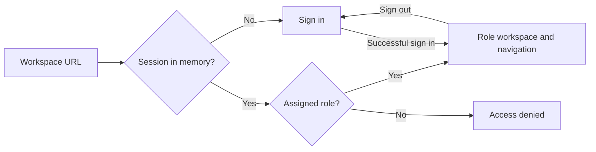

# Workspace flows

| Entry | Access | Destination |
|---|---|---|
| Sign in | Public | Overview for the primary assigned role |
| Register | Public | Student account, then sign in |
| Student | Student role | Overview, Course catalog, My learning |
| Instructor | Instructor role | Overview, My courses |
| Admin | Admin role | Overview, Course approvals, Users |

The auth page uses a single-column form. The workspace uses a header, role-specific navigation and a main content area. Navigation moves above content on small screens. The section routes define the shell for later backlog tasks.

See [TASK-005](TASKS.md#task-005) and [T-005](TESTING_STRATEGY.md#test-register).

